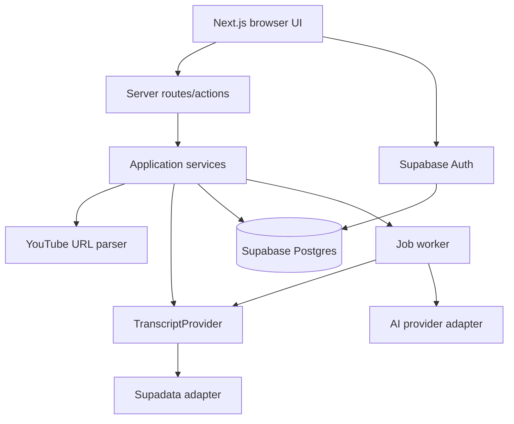

# Sonnetra Architecture

This document describes the current application architecture. The durable-job migration and Supabase project link were verified in Phase 8B. A read-only remote query passed; real transcript-job persistence still requires a successful provider-backed job.

## Scope

Sonnetra turns a canonical YouTube URL into a validated, searchable transcript. The original transcript is immutable; exports and AI outputs are derived data.

## Runtime topology



## Boundaries

- `src/lib/providers` owns external provider adapters and their response validation.
- `src/lib/youtube-url.ts` is the single canonical, synchronous parser. It returns a typed video identity for later provider and job services.
- Server routes authenticate, authorize, rate-limit, and validate input before invoking services.
- Browser code receives public configuration only; service keys remain server-only.
- Long-running retrieval, AI, and batch work is represented by persisted jobs.

## Planned folder structure

```text
src/
  app/                 Next.js routes, layouts, metadata, and API handlers
  components/          Shared accessible UI components
  features/            Transcript, YouTube, search, export, auth, library, AI
  lib/                 Providers, database clients, security, rate limits, exports
  server/              Jobs, workers, and server-only application services
  server/repositories/ Server-side repository contracts and implementations
  types/               Shared domain and transport types
tests/                 Unit, integration, security, and end-to-end tests
supabase/migrations/   Versioned PostgreSQL schema and RLS policies
docs/                  Architecture and operating decisions
```

## Authentication and authorization

Authenticated identity, library access, and account-specific limits are planned but are not implemented in the current transcript UI. Current transcript jobs use anonymous job tokens. When authentication is added, route handlers must obtain the session server-side, pass the subject into services, and never accept a client-supplied owner ID; RLS remains the database backstop.

## Jobs and workers

`POST /api/transcripts` creates a durable `transcript_jobs` row and returns its status and one-time anonymous access token. `POST /api/internal/worker` claims queued work using database leases, records attempts and safe error codes, and transitions only through allowed states. The worker uses the registered Supadata provider. Retryable job failures use bounded exponential backoff; invalid input and unavailable captions do not retry forever. Progress is qualitative unless the provider supplies trustworthy progress.

## Persistence boundary

Database migrations own relational integrity and RLS. Repositories receive a trusted request context and are the application boundary for persistence. `claim_next_transcript_job` and `complete_transcript_job` PostgreSQL functions make claiming and transcript-plus-segment completion atomic. The worker is invoked through the bounded, `WORKER_SECRET`-protected internal route. The browser communicates only with Sonnetra routes and receives the normalized public DTO.

URL validation is a pre-provider boundary: it makes no network or database calls, creates no jobs, and proves neither video existence nor transcript availability. Future jobs consume `videoId`, `canonicalUrl`, `sourceType`, and requested language without reparsing the URL. Deduplication must remain scoped by authenticated user, video ID, and language where private records are involved.

Job creation returns a server-issued anonymous access token once; only its hash is stored. Status and completed-result reads require the `x-job-token`; requests without a user or token cannot enumerate anonymous jobs. The browser polls database state and can recover after refresh using local storage of that capability token. Missing provider configuration prevents successful processing; the worker records a truthful failure rather than creating a fake transcript.

## Export and AI boundaries

Exporters consume the immutable internal segment model and produce independently validated TXT, SRT, VTT, JSON, DOCX, or PDF files. AI jobs read the source transcript and write separate versioned outputs with model metadata and an explicit generated label. Neither export formatting nor AI output mutates the source transcript.

## Delivery phases

1. Foundation and configuration validation.
2. Accessible product shell and transcript workflow.
3. YouTube parsing and provider-backed transcript retrieval.
4. Reader, search, copy, and validated exports.
5. Authenticated library with RLS.
6. AI jobs, usage enforcement, SEO content, and deployment hardening.
